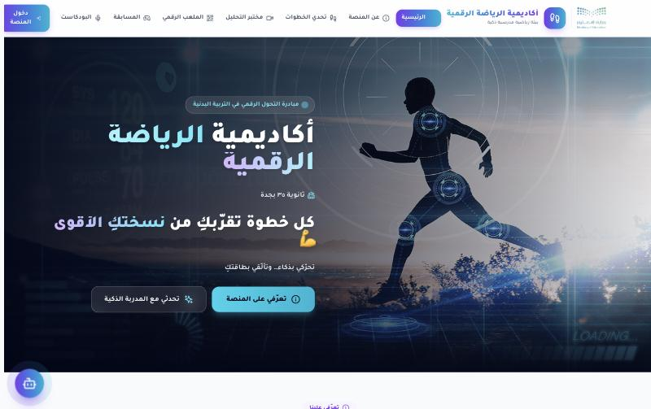
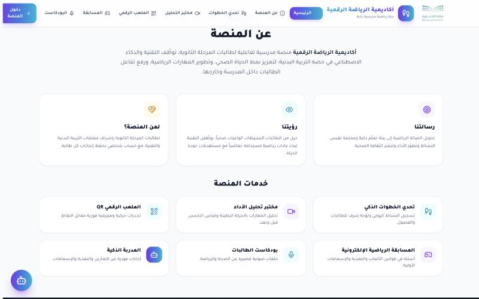
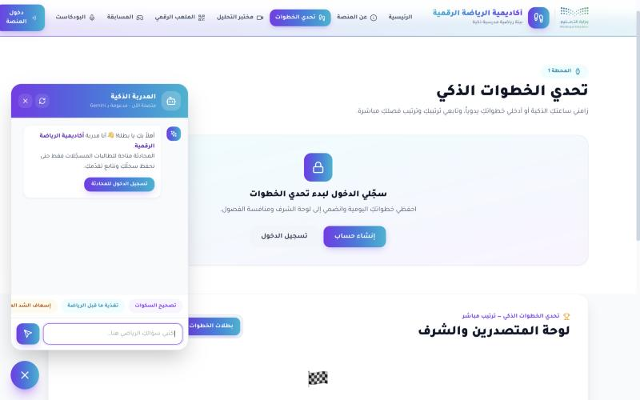
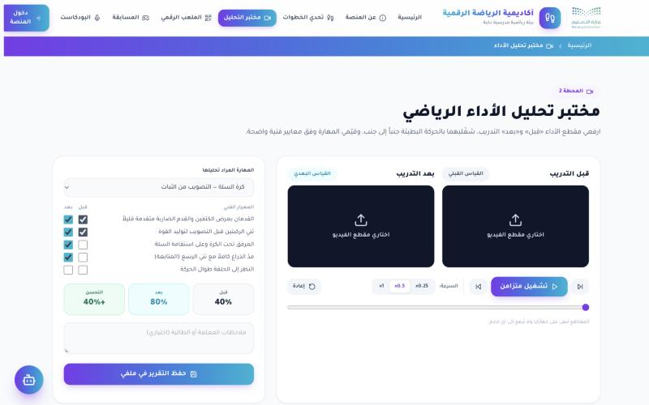
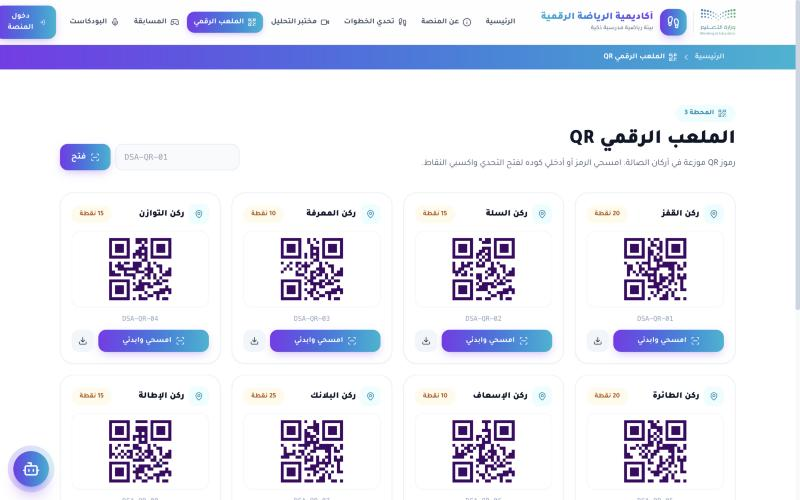
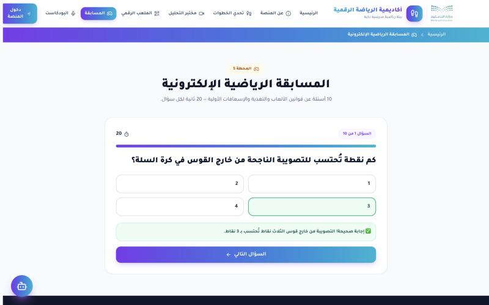
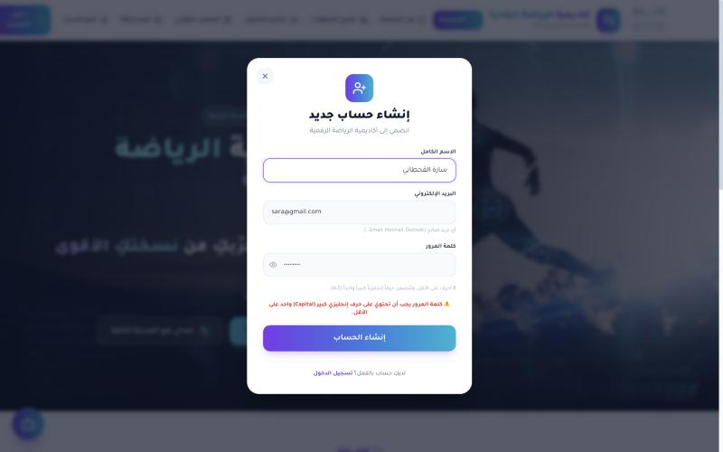

<div align="center">

# 🏃‍♀️ أكاديمية الرياضة الرقمية
### Digital Sports Academy

**منصة رياضية مدرسية ذكية تدمج التربية البدنية بالذكاء الاصطناعي — لطالبات المرحلة الثانوية**
<br>
*A smart school-sports platform that blends physical education with AI — built for high-school students*


**[🔗 جرّب النسخة التجريبية · Live Demo](#-النسخة-التجريبية--live-demo)** &nbsp;·&nbsp; **[⚙️ التشغيل · Setup](SETUP.md)**



</div>

---

## 👩‍💻 المطوّرة · Developer

**غلا عبدالله — Ghala Abdullah**

صمّمتُ وطوّرتُ هذه المنصة **بالكامل بشكل مستقل** كمشروع عمل حر لعميل (مدرسة ثانوية)، من تحليل المتطلبات إلى التصميم والتطوير والاختبار والتسليم.

*I independently designed and built this platform end-to-end as a freelance project for a client (a secondary school): requirements, UI/UX, backend, AI integration, testing, and delivery.*

**ما قمتُ به · What I did:**
- تحليل متطلبات العميل وتحويلها إلى محطات رقمية قابلة للقياس.
- تصميم واجهة عربية (RTL) حديثة ومتجاوبة بهوية بصرية متكاملة.
- بناء الخادم بـ Django و PostgreSQL مع واجهات REST JSON.
- نظام مصادقة كامل: تسجيل، تأكيد البريد برمز حقيقي، استعادة كلمة المرور.
- ربط مدربة ذكاء اصطناعي بـ Google Gemini مع قاعدة معرفة قابلة للتعديل وبدائل تلقائية عند الضغط.
- ربط تسجيل الخطوات من الآيفون (Apple Health عبر Shortcuts) بواجهة API آمنة.
- لوحة إدارة عربية لاعتماد البيانات ومتابعة الطالبات.
- كتابة 15 اختباراً آلياً تغطي المسارات الأساسية.

---

## ✨ المميزات · Features

| المحطة | الوصف |
|---|---|
| 👟 **تحدي الخطوات الذكي** | تسجيل يدوي بلقطة إثبات تعتمدها المعلمة، أو تلقائي من الآيفون. لوحة شرف حيّة للطالبات والفصول. |
| 🎥 **مختبر تحليل الأداء** | رفع مقطعي «قبل» و«بعد» وتشغيلهما متزامنين بالحركة البطيئة، مع تقييم فني يحسب نسبة التحسن. |
| 📱 **الملعب الرقمي QR** | رموز QR في أركان الصالة تفتح تحديات حركية ومعرفية بمؤقت ونقاط، مع تحميل بطاقات الرموز للطباعة. |
| 🤖 **المدربة الذكية** | محادثة فورية مدعومة بـ Gemini، مقيّدة بقاعدة معرفة المدرسة وقواعد سلامة صارمة، وكل محادثة تُسجَّل. |
| 🎮 **المسابقة الإلكترونية** | أسئلة بمؤقت في قوانين الألعاب والتغذية والإسعافات الأولية، مع حفظ أفضل نتيجة. |
| 🎙️ **بودكاست الطالبات** | مساحة جاهزة لحلقات صوتية من إنتاج الطالبات. |
| 🛡️ **لوحة الإدارة** | اعتماد/رفض الخطوات مع معاينة الصور، إدارة قاعدة المعرفة، ومراجعة المحادثات. |

---

## 📸 لقطات الشاشة · Screenshots

<table>
<tr>
<td width="50%"><br><sub><b>عن المنصة</b> — الرسالة والرؤية والخدمات</sub></td>
<td width="50%"><br><sub><b>المدربة الذكية</b> — أيقونة عائمة في كل الصفحات</sub></td>
</tr>
<tr>
<td><br><sub><b>مختبر تحليل الأداء</b> — مقارنة قبل/بعد وحساب التحسن</sub></td>
<td><br><sub><b>الملعب الرقمي QR</b> — تحديات بالنقاط</sub></td>
</tr>
<tr>
<td><br><sub><b>المسابقة الإلكترونية</b> — تصحيح وشرح فوري</sub></td>
<td><br><sub><b>التسجيل</b> — تحقق من القواعد في الواجهة والخادم</sub></td>
</tr>
</table>

---

## 🧱 التقنيات · Tech Stack

| الطبقة | التقنيات |
|---|---|
| **Frontend** | HTML5, Tailwind CSS, Vanilla JavaScript, Chart.js, Lucide Icons, Tajawal (Arabic RTL) |
| **Backend** | Python, Django 5, PostgreSQL (SQLite for local dev) |
| **AI** | Google Gemini (`google-genai` SDK) + school knowledge base + automatic model fallback |
| **Email** | Django SMTP (Gmail / SendGrid / SES) with Arabic HTML templates |
| **Integrations** | iPhone Shortcuts → token-authenticated steps API |
| **Quality** | Django test suite (15 tests), CSRF protection, hashed one-time codes, rate limiting |

---

## 🏗️ البنية · Architecture

```
Browser (RTL SPA)  ──fetch + CSRF──►  Django  ──►  PostgreSQL
                                         │
                                         ├──►  Gmail SMTP   (verification & reset codes)
                                         ├──►  Gemini API   (AI coach + KnowledgeBase context)
iPhone Shortcut ──Bearer token──────────►┘     (daily steps from Apple Health)
```

**أبرز قرارات التصميم · Key decisions**
- نقاط التحديات تُحدَّد في الخادم لا في المتصفح، لمنع التلاعب.
- رموز التحقق تُخزَّن مشفّرة، صالحة 15 دقيقة، بحد أقصى 5 محاولات.
- خطوات الآيفون تأخذ **أعلى قيمة يومية** بدلاً من الجمع، فلا تتكرر عند إعادة التشغيل.
- المدربة الذكية تنتقل تلقائياً لنموذج بديل عند ضغط خوادم Google.

---

## 🔗 النسخة التجريبية · Live Demo

مجلد [`docs/`](docs/) يحتوي نسخة واجهة مستقلة تعمل بدون خادم (البيانات في المتصفح فقط)، منشورة عبر **GitHub Pages**.

*The [`docs/`](docs/) folder contains a standalone, serverless demo of the UI deployed with GitHub Pages.*

---

## ⚙️ التشغيل · Getting Started

```bash
git clone https://github.com/<username>/digital-sports-academy.git
cd digital-sports-academy
python3 -m venv .venv && source .venv/bin/activate
pip install -r requirements.txt
cp .env.example .env          # add Gmail app password + Gemini key
python manage.py migrate
python manage.py seed_knowledge
python manage.py createsuperuser
python manage.py runserver
```

دليل التشغيل الكامل بالعربية (البريد، Gemini، الآيفون، النشر): **[SETUP.md](SETUP.md)**

---

## 📄 الحقوق · License

© 2026 **غلا عبدالله — Ghala Abdullah**. جميع الحقوق محفوظة.
الكود منشور للعرض ضمن معرض الأعمال فقط. لا يُسمح بإعادة الاستخدام أو النشر دون إذن كتابي من المطوّرة. انظر [LICENSE](LICENSE).

*Source is published for portfolio viewing only. All rights reserved.*
